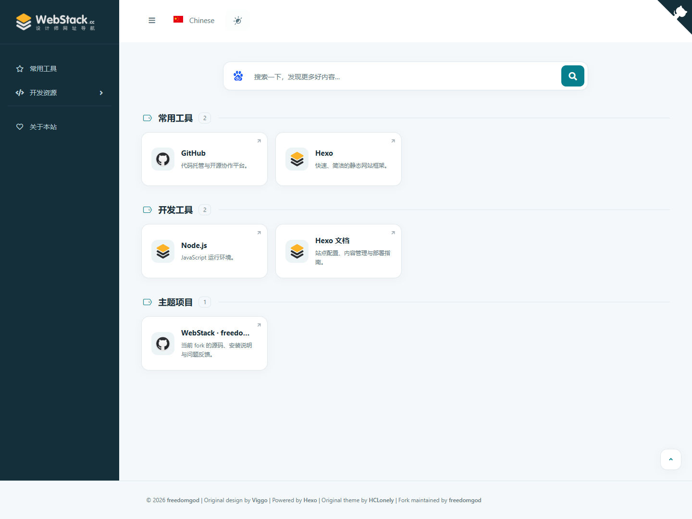

# WebStack Next

WebStack Next is a [Hexo](https://hexo.io/) theme for building a personal navigation site: a card-based directory of websites, organised into categories and subcategories, with a configurable search box.

It is a fork of [HCLonely/hexo-theme-webstack](https://github.com/HCLonely/hexo-theme-webstack), based on the original [WebStackPage / Viggo](https://github.com/WebStackPage/WebStackPage.github.io) design and maintained by [freedomgod](https://github.com/freedomgod). This fork refreshes the card layout, adds light and dark styles, improves keyboard access, and adds an optional local SQLite workflow for managing large bookmark collections.

[中文文档](README_CN.md) · [Install](#installation) · [Configure](#add-categories-and-bookmarks) · [Bookmarks](#bookmarks-yaml-or-sqlite) · [Commands](#command-reference) · [Troubleshooting](#troubleshooting)



## Features

- Responsive card grid with a collapsible sidebar, category icons and two levels of categories.
- Light and dark appearance, with a switch in the header.
- Three card styles (elevated, outline, soft) and three sizes (compact, standard, large), switchable in the header and saved in the browser.
- Search box that opens your preferred external search engine, with configurable providers and optional hot-keyword suggestions.
- Keyboard navigation for the sidebar, search box and resource cards.
- Optional SQLite bookmark database, edited with any SQLite tool and exported during `hexo s`, `hexo g` and `hexo d`.
- An about page and any number of child pages that reuse the same card layout.
- Optional busuanzi page-view statistics.
- All site content and configuration stays in your Hexo site, so theme updates never overwrite it.

## Requirements

| Component | Requirement |
| --- | --- |
| Node.js | 20.19.0 or newer |
| Hexo | 8.x (developed and tested with 8.1.2) |
| SQLite bookmarks (optional) | Node.js 22.13 or newer, using the built-in `node:sqlite` module |
| Git | Only needed for the Git installation method |

This is a directory theme. It provides the homepage, about and child page layouts; it does not ship post, archive, tag or category layouts. If you also publish a blog, use a different theme for it.

## Installation

Run every command in your Hexo site root, the folder that contains `_config.yml`.

### Option A: install from Git (recommended)

```shell
git clone https://github.com/freedomgod/hexo-theme-webstack.git themes/webstack-next
npm install hexo-renderer-pug hexo-util pug js-yaml --save
```

Keep the folder name `webstack-next`: Hexo uses the folder name as the theme name.

Copy the sample configuration to your site root and rename it to `_config.webstack-next.yml`:

```text
themes/webstack-next/_config.example.yml  ->  _config.webstack-next.yml
```

Keep the copy in the site root, not inside `themes/`, and edit it instead of the sample in the theme folder.

### Option B: install a local checkout with npm

Use this when you want to work on the theme and see your changes in a site, including uncommitted changes.

```shell
npm install --install-links "D:/path/to/hexo-theme-webstack" --registry=https://registry.npmjs.org
```

Replace the path with your checkout. The package is installed as `node_modules/hexo-theme-webstack-next`, with the theme name `webstack-next`, so there is nothing new in `themes/`. The install script creates `_config.webstack-next.yml` and imports settings from an existing `_config.webstack.yml` or `source/_data/webstack.yml` when it finds one; on later installs your existing new-theme settings are kept.

Keep `--install-links` as shown. Without it, npm may link the checkout instead of copying it, and the installer then writes imported assets into your working copy.

### Select the theme

```shell
hexo config theme webstack-next
```

This writes `theme: webstack-next` to your site's `_config.yml`. You can also edit that line by hand:

```yaml
theme: webstack-next
```

The old `webstack` theme and its configuration can stay installed; the two names do not conflict.

## Create the homepage

If your site already has a homepage generated by `hexo-generator-index` (the default `hexo init` setup), it works as is: the theme renders the navigation on that index page.

For a navigation-only site, create `source/index.html`:

```yaml
---
layout: index
__index: true
title: My Navigation
---
```

`__index: true` tells the theme that this page is the homepage and should render resource cards. If you keep `hexo-generator-index` alongside this page, give the generator another route in the site's `_config.yml` so both do not write `/index.html`:

```yaml
index_generator:
  path: blog
```

## Preview and build

```shell
hexo clean
hexo s
```

Open <http://localhost:4000>. To generate the static site for deployment:

```shell
hexo generate
```

Upload the generated `public/` folder to your host, or configure a Hexo deployer and run `hexo deploy`. Set the site's `url` in `_config.yml` first; for a site published in a subdirectory, set `root` as well. See the [Hexo deployment guide](https://hexo.io/docs/one-command-deployment).

## Add categories and bookmarks

Everything is configured in `_config.webstack-next.yml` at the site root. The `menu` list is the sidebar; each entry points to a bookmark list through its `config` key:

```yaml
menu:
  - name: Common tools
    icon: far fa-star
    config: hotTools
  - name: Resources
    icon: fas fa-code
    submenu:
      - name: Development
        icon: fas fa-tools
        config: devTools

hotTools:
  - name: GitHub
    url: https://github.com/
    img: /images/logos/github.png
    description: Code hosting and collaboration.

devTools:
  - name: Hexo
    url: https://hexo.io/
    img: /images/favicon.png
    description: A static site framework.
```

A category supports two levels: an entry with `submenu` is a parent, and each child points to its own bookmark list. A parent cannot also have bookmarks of its own.

Each bookmark accepts:

| Field | Required | Description |
| --- | --- | --- |
| `name` | Yes | Card title. |
| `url` | Yes | Destination. HTTP(S), FTP, `mailto:`, local paths and anchors are accepted. |
| `img` | No | Card icon; a URL or a path under your site. Defaults to `/images/favicon.png`. |
| `description` | No | Short description shown under the title. |
| `tags` | No | Text tags, stored in the data and kept when converting to SQLite. The current cards do not display them. |

To keep a long list out of the configuration file, put it in `source/_data/<config>.yml` as a YAML list:

```yaml
# source/_data/hotTools.yml
- name: GitHub
  url: https://github.com/
  img: /images/logos/github.png
  description: Code hosting and collaboration.
```

A data file named after the category's `config` takes precedence over the inline list. Use one source per category; do not define the same list twice.

Put your own images in `source/images/` and reference them as `/images/name.png`. Paths are case-sensitive, including on Windows when the site is later built on Linux.

## Theme settings

The complete set of defaults is in [`_config.example.yml`](_config.example.yml). Keep the `css` and `js` mappings when you edit your copy; the template loads these files directly.

| Setting | Default | Purpose |
| --- | --- | --- |
| `favicon` | `/images/favicon.png` | Browser tab icon. |
| `banner` | `/images/webstack_banner_cn.png` | Image used when the site is shared. |
| `logo.expanded` | `/images/logo@2x.png` | Sidebar logo at full width. |
| `logo.collapsed` | `/images/logo-collapsed@2x.png` | Sidebar logo when collapsed. |
| `logo.dark` | `/images/logo_dark@2x.png` | Legacy key kept for older configurations; the current layout does not read it. |
| `flag` | Chinese | Language link buttons in the header. `default: true` marks the current one. Bundled icons: `flag-cn`, `flag-us`. |
| `search` | `true` | Show or hide the search box. |
| `userDefinedSearchData` | Baidu | Search engines and the default provider; see below. |
| `githubCorner` | This fork's link | HTML for the top-right corner. Set `''` to hide it. |
| `menu` | Sample categories | Sidebar structure and bookmark lists. |
| `expandAll` | `false` | Expand all submenus on load. |
| `bookmark_db` | Disabled | Optional SQLite bookmark source; see [Bookmarks](#bookmarks-yaml-or-sqlite). |
| `since` | `2026` | Site founding year shown in the footer. |
| `about` | `/about/` link | Sidebar link to the about page. Set `about: {}` to hide it. |
| `aboutPage` | Sample text | Content of the about page. |
| `busuanzi` | Disabled | Visitor statistics. `position` is `sidebar` or `footer`; `$pv` and `$uv` are placeholders. |
| `custom.head` | empty | HTML added to `<head>`. |
| `custom.body` | empty | HTML added before `</body>`. |
| `css`, `js` | Bundled files | Stylesheet and script URLs. |

To change the default search engine and suggested providers:

```yaml
userDefinedSearchData:
  custom: true
  thisSearch: https://www.google.com/search?q=
  thisSearchIcon: url(https://www.google.com/favicon.ico)
  hotStatus: false
  data:
    - name: Google
      img: url(https://www.google.com/favicon.ico)
      url: https://www.google.com/search?q=
```

`img` is the icon CSS value and `url` is the search URL prefix. The search box sends the query to the selected external engine; it does not filter the cards. With `hotStatus: true`, suggestions come from Baidu for every provider, so the browser must be able to reach `sp0.baidu.com`.

For colours, spacing, corners and shadows, edit the `--ws-*` custom properties in `source/css/hclonely.css`. Dark mode overrides live under `body.night`. If you would rather not edit theme files, load extra CSS through `custom.head`.

## Bookmarks: YAML or SQLite

Bookmarks live in YAML by default: the `menu` and list entries in `_config.webstack-next.yml`, plus optional files in `source/_data/`. That is enough for a few dozen links and keeps everything in one place.

For hundreds of links, or if you prefer a database editor, enable SQLite mode. The database stays on your computer, the published site is still static, and the YAML settings for appearance remain untouched.

### 1. Convert your existing YAML bookmarks

```shell
hexo bookmarks export-db
```

This reads the homepage `menu` and every referenced list (inline or in `source/_data/`) and writes `.webstack/bookmarks.sqlite`. Category order, icons and hierarchy, bookmark order, names, links, images, descriptions and tags are preserved. It does not modify your YAML files, does not enable SQLite, and does not generate pages.

An existing database is never overwritten. To write somewhere else:

```shell
hexo bookmarks export-db --output .webstack/current-bookmarks.sqlite
```

Then set `bookmark_db.path` to that file. The output must stay inside `.webstack/`; the command refuses paths in `source/` or `public/`.

`export-db` converts homepage navigation only. Lists defined in child page front matter are not merged into this database. To back up a database that is already in use, use your SQLite tool's backup or export feature.

### 2. Enable the database

Add the following to `_config.webstack-next.yml`:

```yaml
bookmark_db:
  enable: true
  path: .webstack/bookmarks.sqlite
```

The path is relative to the site root and must stay inside `.webstack/`. While the database is enabled, it replaces the navigation used for rendering. Your colours, logos, about page and other settings keep coming from the configuration file.

If you have no bookmarks yet, create a sample database instead of exporting:

```shell
hexo bookmarks init
```

To start from an existing Bookmark.db (the format used by the original WebStack project):

```shell
hexo bookmarks init --from "D:/path/to/Bookmark.db"
```

Initialization copies a consistent snapshot of the source and leaves it untouched. It refuses to overwrite an existing database and adds `/.webstack/` to the site's `.gitignore`.

### 3. Edit and publish

Open `.webstack/bookmarks.sqlite` in any SQLite editor, edit the `categories` and `bookmarks` tables, and commit the transaction. Then:

- Restart `hexo s` to preview. There is no file watcher for the database.
- Run `hexo g` to build, or `hexo d` to build and deploy.

The theme exports the database to `webstack.generated.yml` before each generation, then renders from that data. Do not edit `webstack.generated.yml`; it is overwritten. Also keep the database out of `source/` and `public/`: the theme enforces this.

### Database schema

The database uses schema version 1.

`categories`:

| Column | Meaning |
| --- | --- |
| `id` | Integer primary key. Omit it on insert to let SQLite assign one. |
| `parent_id` | `NULL` for a top-level category, otherwise the parent's `id`. |
| `name` | Display name. |
| `icon` | Font Awesome 5 classes, for example `fas fa-tools`. Defaults to `fas fa-folder`. |
| `sort_order` | Integer, ascending. Equal values fall back to `id`. |
| `enabled` | `1` to show, `0` to hide. A hidden parent hides its children. |

`bookmarks`:

| Column | Meaning |
| --- | --- |
| `id` | Integer primary key. Can be assigned by SQLite. |
| `category_id` | Category that contains the bookmark. |
| `name`, `url` | Display name and destination. |
| `img` | Image URL or site path. Defaults to `/images/favicon.png`. |
| `description` | Description text. Defaults to empty. |
| `tags` | Optional tag text. Defaults to empty. |
| `sort_order`, `enabled` | Same rules as categories. |

Categories support two levels. A parent category with children cannot contain bookmarks directly. Deleting a category requires moving or deleting its bookmarks first. Orphaned, cyclic and deeper-than-two-level structures are rejected, including when `enabled` is `0`.

The theme turns each category into a list key such as `sqlite_category_1`, so your existing named YAML lists can stay as backups.

Adding a category and a bookmark:

```sql
PRAGMA foreign_keys = ON;
BEGIN;
INSERT INTO categories (name, icon, sort_order)
VALUES ('Documentation', 'fas fa-book', 30);
INSERT INTO bookmarks (category_id, name, url, img, description, tags, sort_order)
VALUES (last_insert_rowid(), 'SQLite', 'https://sqlite.org/',
        '/images/favicon.png', 'SQLite documentation', 'database,docs', 10);
COMMIT;
```

### Command reference

Run these in the Hexo site root with the theme active. `hexo bookmarks` is a command provided by the theme, not a Hexo built-in.

| Command | What it does |
| --- | --- |
| `hexo bookmarks init` | Creates `.webstack/bookmarks.sqlite` from the bundled sample. |
| `hexo bookmarks init --from <path>` | Copies an existing Bookmark.db into the private directory without changing the source. |
| `hexo bookmarks export-db` | Converts the current YAML navigation into a new database. |
| `hexo bookmarks export-db --output <path>` | Writes the conversion to a different file inside `.webstack/`. |
| `hexo bookmarks export` | Writes the current database to `webstack.generated.yml` without generating pages. |

`hexo s`, `hexo g` and `hexo d` refresh the generated navigation automatically when the database is enabled. `hexo s --static` serves the existing `public/` folder, so run `hexo g` first if you changed bookmarks.

### Notes and limits

- The database, its WAL/journal files and `webstack.generated.yml` are local working files. `.webstack/` is added to `.gitignore` and nothing from it is published.
- A CI build without the database cannot render SQLite bookmarks. Either commit the generated navigation as YAML and disable SQLite there, or provide the database in the CI environment.
- The legacy `Bookmark.db` schema (`category` and `bookmark` tables) is also read directly. Its icons are mapped to Font Awesome 5; iconfont fonts are not loaded.
- To return to YAML bookmarks, set `bookmark_db.enable: false`. The generated YAML is then ignored.

## About page and child pages

Create `source/about/index.html` to enable the sidebar's about link:

```yaml
---
layout: page
type: about
title: About
---
```

Edit `aboutPage.website` and `aboutPage.webmaster` in `_config.webstack-next.yml` to replace the sample text. If you do not want the page, set `about: {}`.

Child pages let you publish extra directories that reuse the card layout. Create `source/child/index.html`:

```yaml
---
layout: page
type: child
title: Development resources
menu:
  - name: Development
    icon: fas fa-code
    config: childTools
childTools:
  - name: GitHub
    url: https://github.com/
    img: /images/logos/github.png
    description: Code hosting and collaboration.
---
```

A child page inherits the theme settings and may override them in its front matter. Its lists can also live in `source/_data/child/childTools.yml`. See the working examples in [`dev/source/child/index.html`](dev/source/child/index.html) and [`dev/source/about/index.html`](dev/source/about/index.html).

## Update the theme

Your configuration and content live in the site root, so updating the theme does not touch them. Never edit files inside `themes/webstack-next` or `node_modules/hexo-theme-webstack-next`; changes there are lost on the next update.

### Git installation

```shell
git -C themes/webstack-next pull --ff-only
hexo clean
```

Run `npm install` in the site root if the update adds or changes dependencies. Compare your `_config.webstack-next.yml` with the new `_config.example.yml` for new settings.

### Local npm installation

Reinstall from the checkout:

```shell
npm install --install-links "D:/path/to/hexo-theme-webstack" --registry=https://registry.npmjs.org
hexo clean
```

npm may reuse a cached copy when the package version has not changed, leaving old files such as `lib/bookmark-hexo.cjs` in place. If a command or a fix seems missing after reinstalling, build a tarball and install that instead:

```shell
# In the theme checkout:
npm pack
# In the Hexo site:
npm install "D:/path/to/hexo-theme-webstack/hexo-theme-webstack-next-<version>.tgz"
hexo clean
```

Check the installed version with:

```shell
node -e "console.log(require('hexo-theme-webstack-next/package.json').version)"
```

## Troubleshooting

| Symptom | Fix |
| --- | --- |
| `Console bookmarks has not been registered` | Run the command in the site root, make sure `theme: webstack-next` is active, and do not use `--safe`, which skips theme scripts. |
| `hexo bookmarks export-db` prints `Usage: hexo bookmarks <init\|export>` | The installed copy predates the `export-db` command. Update the theme (see above) and run it again. |
| `SQLite bookmarks require Node.js 22.13+` | Check `node --version` in the same terminal, or leave SQLite mode disabled. |
| `Bookmark database already exists` | Initialization runs once. Edit the existing database, or choose a new path under `.webstack/`. |
| `Bookmark database missing` | Run `hexo bookmarks init` or `export-db`, and check that `bookmark_db.path` is correct and relative to the site root. |
| Bookmark edits do not appear | Commit the editor's transaction, edit the private copy (not an import source), and restart `hexo s`. For `hexo s --static`, run `hexo g` first. |
| `The bookmark database must be inside the private .webstack/ directory` | Move the file into `.webstack/`. Paths in `source/` and `public/` are rejected on purpose. |
| Database is locked | Finish the write transaction in your editor. The theme waits up to three seconds and cannot read uncommitted changes. |
| Category/data conflict | The error names the conflicting `source/_data/` file. Rename or remove it, or fix the category references. |
| Refusing to overwrite `webstack.generated.yml` | The file was created by hand. Move it aside, or keep manual navigation in YAML mode. |
| Images do not load | Put them in `source/images/`, reference them as `/images/name.png`, and match the case of the file name. |
| Cards are missing on the homepage | Add `__index: true` to the homepage front matter, or use a page generated by `hexo-generator-index`. |
| `hexo d` publishes nothing | Configure `deploy` in `_config.yml` and install the matching deployer package. The theme only prepares the files. |

## Development

These commands run in the theme checkout, not in a site.

```shell
npm ci
npm run dev
```

`npm run dev` starts a Hexo development site at <http://localhost:4000> with three pages: the homepage, `/about/` and `/child/`. It uses [`dev/_config.yml`](dev/_config.yml), `dev/source` and `_config.example.yml`; restart after changing configuration.

```shell
npm run build   # generate the development site
npm test        # install check + bookmark and installer tests
```

Tests build a copied-theme site and cover SQLite initialization, legacy imports, validation, server startup and deployment refresh. They require Node.js 22.13 or newer. Run `npm run bookmarks:sample` to rebuild [`examples/bookmarks.sqlite`](examples/bookmarks.sqlite) from [`examples/bookmarks.sql`](examples/bookmarks.sql). Generated files go to `.hexo-dev/` and `output/`, which are excluded from Git and from the npm package.

## Credits and license

- Fork maintenance: [freedomgod](https://github.com/freedomgod/hexo-theme-webstack).
- Original theme: [HCLonely/hexo-theme-webstack](https://github.com/HCLonely/hexo-theme-webstack).
- Original design: [WebStackPage / Viggo](https://github.com/WebStackPage/WebStackPage.github.io).
- Static site framework: [Hexo](https://hexo.io/).

Report fork-specific problems in [this repository's Issues](https://github.com/freedomgod/hexo-theme-webstack/issues). The theme is released under the [MIT license](LICENSE); original copyright and third-party notices are preserved. The bundled WebStack logos and sample images are placeholders for your own branding.
