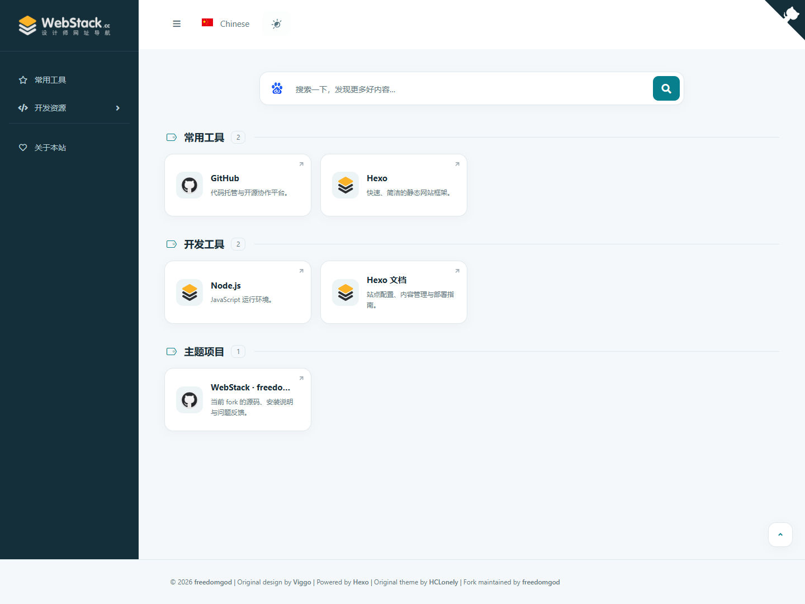

# WebStack Next · Hexo 导航主题

WebStack Next 是一个用来搭建个人网址导航的 [Hexo](https://hexo.io/) 主题：按分类整理网站，以卡片形式展示，并提供可配置的搜索框。

本主题由 [freedomgod](https://github.com/freedomgod) 基于 [HCLonely/hexo-theme-webstack](https://github.com/HCLonely/hexo-theme-webstack) 二次开发，沿用 [WebStackPage / Viggo](https://github.com/WebStackPage/WebStackPage.github.io) 的原始设计。这个分支重做了卡片布局，增加了明暗两套外观和键盘操作，并提供了可选的本地 SQLite 书签管理方式。

[English](README.md) · [安装](#安装) · [添加分类与网址](#添加分类与网址) · [书签](#书签yaml-或-sqlite) · [常见问题](#常见问题)



## 功能

- 响应式卡片网格，侧边栏可折叠，分类支持图标和两级结构。
- 明暗两套配色，页头可直接切换。
- 搜索框可调用外部搜索引擎，引擎可配置，并可选显示搜索热词建议。
- 侧边栏、搜索框和卡片均可用键盘操作。
- 可选的 SQLite 书签库：用任意 SQLite 工具编辑，`hexo s`、`hexo g`、`hexo d` 时自动读取。
- 自带关于页，并可创建任意数量的子页面，复用同一套卡片布局。
- 可选的 busuanzi 访问统计。
- 站点内容与配置都放在 Hexo 站点里，更新主题不会覆盖。

## 环境要求

| 组件 | 要求 |
| --- | --- |
| Node.js | 20.19.0 或更高 |
| Hexo | 8.x（开发与测试使用 8.1.2） |
| SQLite 书签（可选） | Node.js 22.13 或更高，使用内置的 `node:sqlite` |
| Git | 仅在用 Git 方式安装时需要 |

这是一个目录主题，只提供首页、关于页和子页面布局，不包含文章、归档、标签和分类布局。如果你还要写博客，请为博客另选主题。

## 安装

以下命令都在 Hexo 站点根目录执行，也就是包含 `_config.yml` 的那个目录。

### 方式一：从 Git 安装（推荐）

```shell
git clone https://github.com/freedomgod/hexo-theme-webstack.git themes/webstack-next
npm install hexo-renderer-pug hexo-util pug js-yaml --save
```

目录名必须保持 `webstack-next`，Hexo 会把目录名当作主题名。

把主题自带的配置样例复制到站点根目录，并命名为 `_config.webstack-next.yml`：

```text
themes/webstack-next/_config.example.yml  ->  _config.webstack-next.yml
```

这份配置要留在站点根目录，不要放回 `themes/` 里。以后只改这份副本，不要改主题目录里的样例文件。

### 方式二：用 npm 安装本地目录

如果你想一边改主题、一边在站点里看效果（包括未提交的改动），用这种方式。

```shell
npm install --install-links "D:/path/to/hexo-theme-webstack" --registry=https://registry.npmjs.org
```

把路径换成你的主题目录。安装后主题位于 `node_modules/hexo-theme-webstack-next`，主题名仍是 `webstack-next`，`themes/` 下不会多出目录。安装脚本会自动创建 `_config.webstack-next.yml`；如果站点里已有 `_config.webstack.yml` 或 `source/_data/webstack.yml`，会以它为模板。以后再安装时会保留你已经改好的新主题配置。

请保留示例中的 `--install-links`。不加这个参数时，npm 可能直接链接主题目录，安装脚本导入的旧主题素材就会写进你的开发副本。

### 启用主题

```shell
hexo config theme webstack-next
```

这条命令会在站点的 `_config.yml` 中写入 `theme: webstack-next`，也可以手动修改：

```yaml
theme: webstack-next
```

旧的 `webstack` 主题及其配置可以继续保留，两个主题名不冲突。

## 创建首页

如果站点已有 `hexo-generator-index` 生成的首页（`hexo init` 的默认结构），不需要额外操作，主题会在这个首页上渲染导航。

如果只想做纯导航站，创建 `source/index.html`：

```yaml
---
layout: index
__index: true
title: 我的导航
---
```

`__index: true` 告诉主题这是首页，需要渲染资源卡片。如果同时保留 `hexo-generator-index`，请在站点 `_config.yml` 里给它换一个路径，避免两边都写 `/index.html`：

```yaml
index_generator:
  path: blog
```

## 预览与构建

```shell
hexo clean
hexo s
```

浏览器打开 <http://localhost:4000>。生成用于部署的静态文件：

```shell
hexo generate
```

把生成的 `public/` 上传到主机，或者配置 Hexo 部署插件后执行 `hexo deploy`。部署前请先在 `_config.yml` 中设置站点 `url`；如果站点发布在子目录，还要设置 `root`。具体做法见 [Hexo 部署文档](https://hexo.io/zh-cn/docs/one-command-deployment)。

## 添加分类与网址

所有内容都在站点根目录的 `_config.webstack-next.yml` 中。`menu` 是侧边栏结构，每一项通过 `config` 指向一份网址列表：

```yaml
menu:
  - name: 常用工具
    icon: far fa-star
    config: hotTools
  - name: 开发资源
    icon: fas fa-code
    submenu:
      - name: 开发工具
        icon: fas fa-tools
        config: devTools

hotTools:
  - name: GitHub
    url: https://github.com/
    img: /images/logos/github.png
    description: 代码托管与开源协作平台。

devTools:
  - name: Hexo
    url: https://hexo.io/
    img: /images/favicon.png
    description: 快速、简洁的静态网站框架。
```

分类最多两级：带 `submenu` 的是父分类，每个子项再指向自己的网址列表。父分类本身不能再直接放网址。

每个网址支持以下字段：

| 字段 | 必填 | 说明 |
| --- | --- | --- |
| `name` | 是 | 卡片标题。 |
| `url` | 是 | 目标地址，支持 HTTP(S)、FTP、`mailto:`、本地路径和锚点。 |
| `img` | 否 | 卡片图标，可以是图片地址或站点内路径，默认 `/images/favicon.png`。 |
| `description` | 否 | 标题下方的简短说明。 |
| `tags` | 否 | 文本标签，会写入数据并在转换为 SQLite 时保留；当前卡片不显示标签。 |

列表很长时，可以放到 `source/_data/<config>.yml`，内容就是一个 YAML 列表：

```yaml
# source/_data/hotTools.yml
- name: GitHub
  url: https://github.com/
  img: /images/logos/github.png
  description: 代码托管与开源协作平台。
```

与分类 `config` 同名的数据文件优先于配置文件里的内联列表。同一份列表只保留一个来源，不要两处都写。

自己的图片放在 `source/images/`，引用为 `/images/文件名.png`。路径区分大小写；在 Windows 上编辑、到 Linux 上构建时尤其要注意。

## 主题配置

完整的默认配置见 [`_config.example.yml`](_config.example.yml)。修改副本时请保留 `css` 和 `js` 映射，模板会直接引用这些文件。

| 配置项 | 默认值 | 作用 |
| --- | --- | --- |
| `favicon` | `/images/favicon.png` | 浏览器标签页图标。 |
| `banner` | `/images/webstack_banner_cn.png` | 站点被分享时使用的图片。 |
| `logo.expanded` | `/images/logo@2x.png` | 侧边栏展开时的 Logo。 |
| `logo.collapsed` | `/images/logo-collapsed@2x.png` | 侧边栏收起时的 Logo。 |
| `logo.dark` | `/images/logo_dark@2x.png` | 旧版字段，仅为兼容旧配置保留；当前布局不读取。 |
| `flag` | 中文 | 页头的语言链接按钮，`default: true` 表示当前语言。内置图标：`flag-cn`、`flag-us`。 |
| `search` | `true` | 是否显示搜索框。 |
| `userDefinedSearchData` | 百度 | 搜索引擎和默认引擎，见下方示例。 |
| `githubCorner` | 本分支仓库链接 | 右上角角标 HTML，设为 `''` 可隐藏。 |
| `menu` | 示例分类 | 侧边栏结构与网址列表。 |
| `expandAll` | `false` | 页面加载时是否展开所有子分类。 |
| `bookmark_db` | 关闭 | 可选的 SQLite 书签来源，见[书签](#书签yaml-或-sqlite)。 |
| `since` | `2026` | 页脚显示的建站年份。 |
| `about` | `/about/` 链接 | 侧边栏的关于页入口，设为 `about: {}` 可隐藏。 |
| `aboutPage` | 示例文字 | 关于页内容。 |
| `busuanzi` | 关闭 | 访问统计。`position` 可选 `sidebar` 或 `footer`，`$pv`、`$uv` 为占位符。 |
| `custom.head` | 空 | 插入到 `<head>` 的 HTML。 |
| `custom.body` | 空 | 插入到 `</body>` 前的 HTML。 |
| `css`、`js` | 主题内置文件 | 样式表和脚本地址。 |

修改默认搜索引擎和候选列表：

```yaml
userDefinedSearchData:
  custom: true
  thisSearch: https://www.google.com/search?q=
  thisSearchIcon: url(https://www.google.com/favicon.ico)
  hotStatus: false
  data:
    - name: Google
      img: url(https://www.google.com/favicon.ico)
      url: https://www.google.com/search?q=
```

`img` 是图标的 CSS 值，`url` 是搜索地址前缀。搜索框会把关键词交给选中的外部搜索引擎，不会过滤本站卡片。`hotStatus: true` 时，热词建议统一来自百度，与当前选中的引擎无关，因此浏览器需要能访问 `sp0.baidu.com`。

颜色、间距、圆角和阴影由 `source/css/hclonely.css` 里的 `--ws-*` 变量控制，暗色覆盖写在 `body.night` 下。不想改主题文件时，可以通过 `custom.head` 加载额外的 CSS。

## 书签：YAML 或 SQLite

默认使用 YAML：`_config.webstack-next.yml` 里的 `menu` 和各份列表，加上可选的 `source/_data/` 文件。几十个网址用这种方式最省事。

网址有几百条，或者你更习惯用数据库工具时，可以启用 SQLite 模式。数据库只保存在本机，发布出去的仍然是静态页面，外观相关的 YAML 配置不受影响。

### 1. 把现有 YAML 书签转成数据库

```shell
hexo bookmarks export-db
```

命令会读取首页的 `menu` 和它引用的所有列表（内联的或放在 `source/_data/` 的），写入 `.webstack/bookmarks.sqlite`。分类顺序、图标、层级关系，以及网址的顺序、名称、链接、图片、说明和标签都会保留。它不会修改 YAML 文件，不会自动开启 SQLite，也不会生成页面。

目标文件已存在时不会覆盖。需要换个位置时：

```shell
hexo bookmarks export-db --output .webstack/current-bookmarks.sqlite
```

然后把 `bookmark_db.path` 指向这个文件。输出路径必须位于 `.webstack/` 内，命令会拒绝写入 `source/` 和 `public/`。

`export-db` 只转换首页导航；写在子页面 front matter 里的列表不会合并进来。如果数据库正在使用，需要备份请用 SQLite 工具自带的备份或导出功能。

### 2. 启用数据库

在 `_config.webstack-next.yml` 中加入：

```yaml
bookmark_db:
  enable: true
  path: .webstack/bookmarks.sqlite
```

路径相对于站点根目录，且必须位于 `.webstack/` 内。启用后，导航数据以数据库为准；配色、Logo、关于页等其他配置仍然从配置文件读取。

如果还没有任何书签，可以先生成一个样例数据库：

```shell
hexo bookmarks init
```

也可以从原版 WebStack 的 Bookmark.db 导入：

```shell
hexo bookmarks init --from "D:/path/to/Bookmark.db"
```

初始化会复制一份一致的快照，源文件保持不变。目标数据库已存在时不会覆盖；同时会把 `/.webstack/` 写入站点的 `.gitignore`。

### 3. 修改与发布

用任意 SQLite 编辑器打开 `.webstack/bookmarks.sqlite`，修改 `categories` 和 `bookmarks` 两张表并提交事务。然后：

- 重启 `hexo s` 预览。主题不会监听数据库文件的变化。
- 执行 `hexo g` 构建，或执行 `hexo d` 构建并部署。

每次生成前，主题会把数据库导出为 `webstack.generated.yml`，再从这份数据渲染。不要手动编辑 `webstack.generated.yml`，它会被覆盖。数据库也不要放进 `source/` 或 `public/`，主题会检查并拒绝这类路径。

### 表结构

数据库的 schema 版本为 1。

`categories`：

| 字段 | 含义 |
| --- | --- |
| `id` | 整数主键。插入时可以留空，由 SQLite 分配。 |
| `parent_id` | 顶级分类为 `NULL`，子分类填父分类的 `id`。 |
| `name` | 显示名称。 |
| `icon` | Font Awesome 5 类名，例如 `fas fa-tools`，默认 `fas fa-folder`。 |
| `sort_order` | 整数，升序排列；相同时按 `id` 排序。 |
| `enabled` | `1` 显示，`0` 隐藏。父分类隐藏时，其子分类也隐藏。 |

`bookmarks`：

| 字段 | 含义 |
| --- | --- |
| `id` | 整数主键，可由 SQLite 分配。 |
| `category_id` | 所属分类。 |
| `name`、`url` | 显示名称和目标地址。 |
| `img` | 图片地址或站点内路径，默认 `/images/favicon.png`。 |
| `description` | 说明文字，默认空。 |
| `tags` | 可选的标签文本，默认空。 |
| `sort_order`、`enabled` | 规则同分类。 |

分类最多两级。已经有子分类的父分类不能直接放网址；删除分类前要先移走或删除它下面的网址。孤立分类、循环引用和超过两级的结构都会被拒绝，即使 `enabled` 为 `0`。

主题会把每个分类转成 `sqlite_category_1` 这样的列表键，因此原有那些有名字的 YAML 列表可以留作备份。

新增一个分类和一个网址：

```sql
PRAGMA foreign_keys = ON;
BEGIN;
INSERT INTO categories (name, icon, sort_order)
VALUES ('文档资料', 'fas fa-book', 30);
INSERT INTO bookmarks (category_id, name, url, img, description, tags, sort_order)
VALUES (last_insert_rowid(), 'SQLite', 'https://sqlite.org/',
        '/images/favicon.png', 'SQLite 官方文档', '数据库,文档', 10);
COMMIT;
```

### 命令一览

这些命令要在 Hexo 站点根目录、主题已启用的状态下执行。`hexo bookmarks` 是主题提供的命令，不是 Hexo 内置命令。

| 命令 | 作用 |
| --- | --- |
| `hexo bookmarks init` | 用内置样例创建 `.webstack/bookmarks.sqlite`。 |
| `hexo bookmarks init --from <路径>` | 把已有的 Bookmark.db 复制到私有目录，源文件不变。 |
| `hexo bookmarks export-db` | 把当前 YAML 导航转换成新数据库。 |
| `hexo bookmarks export-db --output <路径>` | 转换到 `.webstack/` 内的其他文件。 |
| `hexo bookmarks export` | 把当前数据库导出为 `webstack.generated.yml`，不生成页面。 |

启用数据库后，`hexo s`、`hexo g` 和 `hexo d` 都会自动刷新生成的导航数据。`hexo s --static` 直接使用已有的 `public/`，改动书签后要先执行 `hexo g`。

### 注意事项

- 数据库、它的 WAL/journal 文件以及 `webstack.generated.yml` 都是本地工作文件。`.webstack/` 会写入 `.gitignore`，其中的内容不会发布。
- CI 构建如果拿不到数据库，就无法渲染 SQLite 书签。可以在 CI 中使用提交为 YAML 的导航并关闭 SQLite，或者在 CI 环境提供数据库文件。
- 旧版 `Bookmark.db` 的 `category`、`bookmark` 表也能直接读取；图标会映射到 Font Awesome 5，不加载 iconfont 字体。
- 想退回 YAML 书签，把 `bookmark_db.enable` 设为 `false` 即可，生成的 YAML 会被忽略。

## 关于页与子页面

创建 `source/about/index.html`，侧边栏的关于链接就会生效：

```yaml
---
layout: page
type: about
title: 关于
---
```

在 `_config.webstack-next.yml` 中修改 `aboutPage.website` 和 `aboutPage.webmaster` 替换示例文字。不需要这一页时，设置 `about: {}`。

子页面用于发布额外的目录，并复用卡片布局。创建 `source/child/index.html`：

```yaml
---
layout: page
type: child
title: 开发资源
menu:
  - name: 开发工具
    icon: fas fa-code
    config: childTools
childTools:
  - name: GitHub
    url: https://github.com/
    img: /images/logos/github.png
    description: 代码托管与开源协作平台。
---
```

子页面默认继承主题配置，也可以在 front matter 中覆盖。它的列表同样可以放在 `source/_data/child/childTools.yml`。可运行的示例见 [`dev/source/child/index.html`](dev/source/child/index.html) 和 [`dev/source/about/index.html`](dev/source/about/index.html)。

## 更新主题

配置和内容都在站点根目录，更新主题不会动它们。不要修改 `themes/webstack-next` 或 `node_modules/hexo-theme-webstack-next` 里的文件，那里的改动会在下次更新时丢失。

### Git 安装

```shell
git -C themes/webstack-next pull --ff-only
hexo clean
```

如果新版本增加了依赖，在站点根目录再执行一次 `npm install`。把 `_config.webstack-next.yml` 与新版的 `_config.example.yml` 对比一下，补上新增配置。

### npm 本地目录安装

重新从主题目录安装：

```shell
npm install --install-links "D:/path/to/hexo-theme-webstack" --registry=https://registry.npmjs.org
hexo clean
```

当版本号没变时，npm 可能复用缓存，导致 `lib/bookmark-hexo.cjs` 之类的文件仍是旧的。如果重新安装后命令或修复仍然缺失，改用打包文件安装：

```shell
# 在主题目录执行：
npm pack
# 在 Hexo 站点目录执行：
npm install "D:/path/to/hexo-theme-webstack/hexo-theme-webstack-next-<版本号>.tgz"
hexo clean
```

查看实际安装的版本：

```shell
node -e "console.log(require('hexo-theme-webstack-next/package.json').version)"
```

## 常见问题

| 现象 | 处理 |
| --- | --- |
| 提示 `Console bookmarks has not been registered` | 在站点根目录执行；确认 `theme: webstack-next` 已启用；不要使用 `--safe`，它会跳过主题脚本。 |
| `hexo bookmarks export-db` 报 `Usage: hexo bookmarks <init\|export>` | 安装的主题版本太旧，还没有 `export-db`。按上面的方法更新主题后重试。 |
| 报 `SQLite bookmarks require Node.js 22.13+` | 在同一个终端里执行 `node --version` 确认版本，或继续使用 YAML 模式。 |
| 报 `Bookmark database already exists` | 初始化只执行一次。直接编辑已有数据库，或在 `.webstack/` 下换一个新路径。 |
| 报 `Bookmark database missing` | 先执行 `hexo bookmarks init` 或 `export-db`，并检查 `bookmark_db.path` 是否正确、是否相对站点根目录。 |
| 修改书签后页面没变化 | 确认编辑器里的事务已提交；确认改的是实际使用的数据库而不是导入来源；重启 `hexo s`；用 `hexo s --static` 时先执行 `hexo g`。 |
| 报 `The bookmark database must be inside the private .webstack/ directory` | 把文件移进 `.webstack/`。`source/` 和 `public/` 下的路径会被有意拒绝。 |
| 数据库被锁定 | 先在编辑器里结束写事务。主题最多等待三秒，且读不到未提交的数据。 |
| 分类与数据文件冲突 | 报错信息会指出冲突的 `source/_data/` 文件。改名、删除该文件，或修正分类引用。 |
| 报拒绝覆盖 `webstack.generated.yml` | 该文件被手动创建过。把它移走，或继续用 YAML 模式维护导航。 |
| 图片不显示 | 放到 `source/images/`，用 `/images/文件名.png` 引用，并检查文件名大小写。 |
| 首页没有卡片 | 在首页 front matter 中加入 `__index: true`，或使用 `hexo-generator-index` 生成的页面。 |
| `hexo d` 没有发布内容 | 在 `_config.yml` 中配置 `deploy`，并安装对应的部署插件。主题只负责准备文件。 |

## 本地开发

以下命令在主题仓库里执行，不在站点里执行。

```shell
npm ci
npm run dev
```

`npm run dev` 会在 <http://localhost:4000> 启动开发站点，包含三个页面：首页、`/about/` 和 `/child/`。它使用 [`dev/_config.yml`](dev/_config.yml)、`dev/source` 和 `_config.example.yml`；修改配置后需要重启。

```shell
npm run build   # 生成开发站点
npm test        # 安装检查 + 书签与安装脚本测试
```

测试会复制一份主题并搭建临时站点，覆盖 SQLite 初始化、旧库导入、数据校验、服务器启动和部署前刷新等场景，需要 Node.js 22.13 或更高版本。执行 `npm run bookmarks:sample` 可以用 [`examples/bookmarks.sql`](examples/bookmarks.sql) 重新生成 [`examples/bookmarks.sqlite`](examples/bookmarks.sqlite)。生成的文件位于 `.hexo-dev/` 和 `output/`，不会进入 Git，也不会打进 npm 包。

## 致谢与许可

- 分支维护：[freedomgod](https://github.com/freedomgod/hexo-theme-webstack)。
- 原主题：[HCLonely/hexo-theme-webstack](https://github.com/HCLonely/hexo-theme-webstack)。
- 原始设计：[WebStackPage / Viggo](https://github.com/WebStackPage/WebStackPage.github.io)。
- 静态框架：[Hexo](https://hexo.io/)。

与本分支相关的问题请提交到[本仓库的 Issues](https://github.com/freedomgod/hexo-theme-webstack/issues)。主题以 [MIT 许可](LICENSE)发布，原作者版权与第三方声明均予保留。仓库内的 WebStack Logo 和示例图片仅作占位，请替换为你自己的素材。
